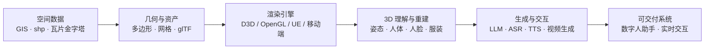
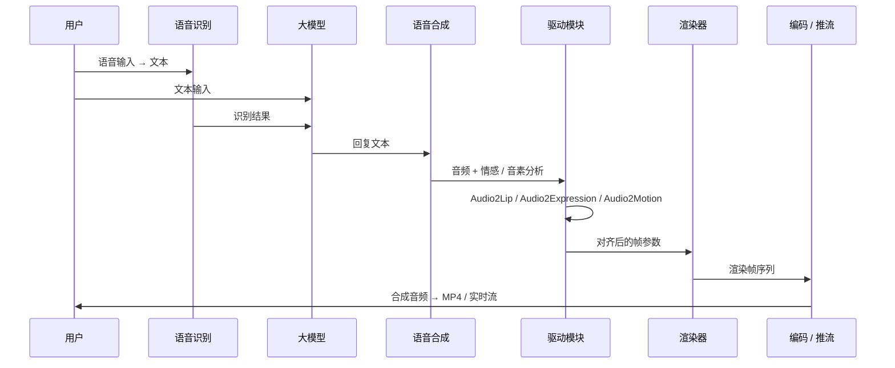
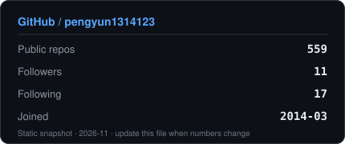

<p align="center">
  
</p>

# 彭云 · WaynePen

### AI 算法工程师 ｜ 3D 视觉 · 数字人 · 图形渲染 · 大模型应用

**把算法做成能跑、能落地、能交付的系统。** 从空间数据与实时渲染出发，走到 3D 人体重建、数字人驱动，再到 LLM / ASR / TTS 与多模态生成。

[](https://github.com/pengyun1314123)
[](https://isocpp.org/)
[](https://www.python.org/)
[](https://pytorch.org/)
[](https://github.com/pengyun1314123)

[关于我](#关于我) · [能力矩阵](#能力矩阵) · [技术栈](#技术栈) · [经历脉络](#经历脉络) · [代表系统](#代表系统数字人实时交互链路) · [关注方向](#关注方向与技术雷达) · [联系](#联系)

---

## 关于我

我是一名偏工程落地的 AI 算法工程师，长期扎根 **3D 视觉与图形学**，近年的工作重心是 **3D / 2D 数字人**以及与大模型的结合。

- **现在**：围绕 3D 人体 / 人脸 / 头发 / 服装重建、姿态估计，结合 LLM、ASR、TTS 构建全栈数字人助手；同时跟进视频生成、3D Gaussian Splatting 与 AI 编程工具链。
- **过去**：从 GIS 大场景空间数据（Google Earth 金字塔瓦片、shp 数据转 3D 建筑）起步，做多边形处理与几何体构建、2D 矢量渲染；随后深耕 PC 端 D3D / OpenGL 实时渲染、移动端与 VR 渲染。
- **底层能力**：对图形管线、性能剖析与移动端包体控制有长期实操经验——曾将渲染模块压缩到 **2 MB 以内**，集成到 App 后相比 Unity 等引擎方案包体缩小数倍。

一句话定位：**连通「数据 → 几何 → 渲染 → 感知 → 生成 → 交互」全链路的人**。

## 能力矩阵

| 方向 | 我能做什么 | 关键词 |
| --- | --- | --- |
| AI 算法与大模型 | 大模型推理 / 微调 / Agent 应用落地，语音与语言模型接入业务系统 | LLM · VLM · RAG · ASR · TTS |
| 视频与多模态生成 | 文本 / 图像到视频、音频驱动的人像动画，关注可控性与一致性 | Text2Video · Image2Human · Image2Motion |
| 3D 视觉与人体理解 | 单目 / 多视角姿态估计，人体、人脸、毛发、服装的重建与参数化 | 3D Pose · Human Mesh · Avatar |
| 图形渲染与物理模拟 | PBR 渲染、布料 / 接触求解、实时场景与角色渲染 | D3D · OpenGL · PBR · Simulation |
| 移动端与 VR | 陀螺仪驱动的稳定旋转控制，移动端性能分析与 trace 调优 | VR · Gyro · Perf Trace · Android |
| 数据工程与工具链 | 大规模空间数据金字塔、矢量数据处理、C++ / Python 工程化 | GIS · shp · C++ · Python · UE |

## 技术栈

| 类别 | 主要使用 |
| --- | --- |
| 语言 | `C++` `Python` `GLSL` `CUDA` |
| AI / 算法 | `PyTorch` `Jittor` `TensorRT` `Transformer` `Diffusion` |
| 3D / 渲染 | `OpenGL` `Direct3D` `Unreal Engine` `glTF` `3D Gaussian Splatting` |
| 数据 / 工程 | `Git` `Linux` `Docker` `Redis` `GIS / 空间数据` |

## 经历脉络

按时间顺序，我的技术领域是这样一层层叠上去的：

<details>
<summary>展开查看完整经历细节</summary>

**阶段一 · 空间数据与几何基础**

- 处理 Google Earth 金字塔结构的大场景数据，完成 shp 等矢量数据到 3D 建筑的转换。
- 积累 3D 多边形处理、几何体构建与 2D 空间矢量渲染的经验。

**阶段二 · PC 端实时渲染**

- 覆盖场景与角色的渲染全流程，主要基于 D3D / OpenGL。
- 涉猎 PBR 材质、光照与物理模拟，建立图形学底层心智模型。

**阶段三 · 移动端与 VR**

- 借助 Oculus 开源代码自研陀螺仪驱动逻辑，在通用手机上实现稳定的旋转控制。
- 深入手机性能分析与 trace 调优，将渲染模块控制在 **2 MB 以内**，相较 Unity 等引擎方案包体缩小数倍。

**阶段四 · 3D 数字人与多模态交互**

- 主攻 3D 姿态估计，以及人体、人脸、头发、服装的重建。
- 结合 LLM、ASR、TTS 构建完整的 3D 数字人助手；2D 方向从 wav2lip 到 3D 高斯数字人均有实践——所谓「2D」，背后其实有大量 3D 先验与参数化方法。

**阶段五 · AI 编程与能力边界扩展**

- AI 编程工具成熟后，个人能力边界得到质的扩展：更快地跨领域验证想法、把算法原型推进到可运行系统。

</details>

从数据到交互，我关注的能力链条：



## 代表系统：数字人实时交互链路

这是我正在推进的交互主流程：用户输入可以是语音或文本，模型输出不止是文字，还携带表情、口型与动作参数，最后统一编排成帧并由渲染器输出视频或实时流。



这个链路里最值得投入的地方，是把**音频、表情、动作、渲染**四条时间线对齐——也就是上面 `ArrangePrepare` 那一步；它决定了数字人是「能说话的贴图」还是「可信的角色」。

## 关注方向与技术雷达

以下是公开开源项目的**跟踪 / 复现仓库，并非本人原创**，列在这里是为了说明我持续投入的技术方向，方便按图索骥交流。

| 方向 | 跟踪的开源实现 |
| --- | --- |
| 3D Gaussian Splatting | [spark](https://github.com/pengyun1314123/spark) · [gsplat](https://github.com/pengyun1314123/gsplat) · [supersplat](https://github.com/pengyun1314123/supersplat) |
| 视频生成 | [Wan2.2](https://github.com/pengyun1314123/Wan2.2) · [seedance2-comfyui](https://github.com/pengyun1314123/seedance2-comfyui) |
| 数字人 / 头像驱动 | [LiveAvatar](https://github.com/pengyun1314123/LiveAvatar) · [FlashAvatar-code](https://github.com/pengyun1314123/FlashAvatar-code) · [opentalking](https://github.com/pengyun1314123/opentalking) · [LiveTalking](https://github.com/pengyun1314123/LiveTalking) |
| 人体重建与姿态估计 | [Multi-RoI](https://github.com/pengyun1314123/Multi-RoI) · [FMPose3D](https://github.com/pengyun1314123/FMPose3D) · [LAM](https://github.com/pengyun1314123/LAM) |
| 大模型推理与 Agent | [vllm](https://github.com/pengyun1314123/vllm) · [minimind](https://github.com/pengyun1314123/minimind) · [awesome-llm-apps](https://github.com/pengyun1314123/awesome-llm-apps) |
| 物理仿真与动作生成 | [ProtoMotions](https://github.com/pengyun1314123/ProtoMotions) · [ppf-contact-solver](https://github.com/pengyun1314123/ppf-contact-solver) |
| AI 工程实践 | [AIGuide](https://github.com/pengyun1314123/AIGuide) · [llama-cookbook](https://github.com/pengyun1314123/llama-cookbook) |

常用工具片段：

```bash
git clone https://chromium.googlesource.com/libyuv/libyuv
```

## 联系

- **GitHub**：[@pengyun1314123](https://github.com/pengyun1314123) — 最方便，欢迎提 Issue 或直接交流。
- **邮箱 / 微信 / LinkedIn**：待补充（补上后可直接展示在这里）。
- **欢迎交流**：3D 重建、数字人方案、AI 应用落地、渲染性能问题。3D 这条路上阅历比较丰富；现在 AI 编程大行其道，也很乐意聊聊它带来的新可能。

<p align="center">
  <a href="https://github.com/pengyun1314123">
    
  </a>
</p>
