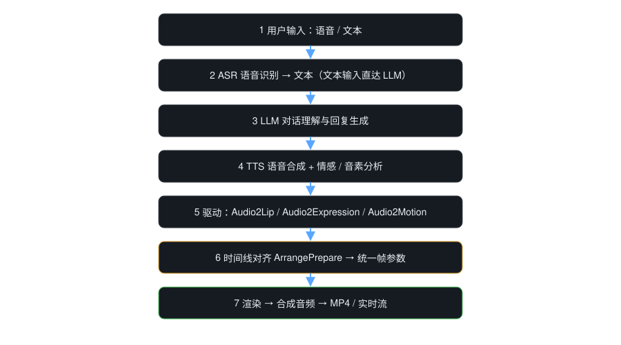

<p align="center">
  
</p>

# 彭云 · WaynePen

### AI 算法与全栈工程师 ｜ 京东 / 腾讯 · 大模型应用 · 数字人 · 3D 视觉

**把算法做成能跑、能落地、能交付的系统。** 目前在京东做算法工程，围绕 LLM / Agent、多模态生成与数字人做 0→1 应用落地；此前在腾讯担任 3D 数字人技术负责人，负责商业化数字人与超写实数字人研发。

[](https://www.jd.com/)
[](https://www.tencent.com/)
[](https://isocpp.org/)
[](https://www.python.org/)
[](https://pytorch.org/)
[](https://github.com/pengyun1314123)

[关于我](#关于我) · [个人优势](#个人优势) · [能力矩阵](#能力矩阵) · [工作经历](#工作经历) · [技术栈](#技术栈) · [代表系统](#代表系统数字人实时交互链路) · [关注方向](#关注方向与技术雷达) · [联系](#联系)

---

## 关于我

我是一名偏工程落地的 AI 算法与全栈工程师，**现任京东算法工程师，此前在腾讯担任 3D 数字人技术负责人**。职业路径从 GIS 空间数据与实时渲染起步，经过 PC / 移动端 / VR 图形引擎与腾讯的 3D 数字人技术攻坚，走到今天京东的大模型应用与 AI 编程全栈交付。

- **京东（当前）**：负责 2D / 3D 数字人全流程研发，LLM / Agent-Server / Skill 系统，多模态生成应用，以及 LLM 与多模态评测平台建设。
- **腾讯（上一段）**：作为 3D 数字人技术负责人，负责商业化数字人、UE5 驱动渲染插件、姿态估计与人体 / 人脸 / 头发 / 服装重建，并参与超写实数字人研发。
- **底层积累**：图形管线、物理模拟、性能剖析与移动端包体控制有长期实操经验——曾将渲染模块压缩到 **2 MB 以内**，集成到 App 后相比 Unity 等引擎方案包体缩小数倍。

一句话定位：**既能写 C++ 渲染管线和 UE 插件，也能用 Python 把 LLM / Agent / 多模态模型串成完整产品的人。**

## 个人优势

- **全栈交付**：熟练掌握基于 LLM 的对话交互系统研发、提示词优化、MCP / A2A / Agent-Server、意图识别与工具调用；熟悉 ASR / LLM / TTS / CGCV 数字人全流程以及算法前后端协作，能单人从 0 到 1 构建完整应用，覆盖 Docker、K8s、Redis、MQ、数据库等工作。
- **多模态生成**：文生图、图生图、文生视频、图生视频、文生 3D、图生 3D 与 3D 纹理生成；熟悉 Tripo、混元 3D 等大模型的自定义部署，UniTex 纹理模型部署，以及 ComfyUI 部署与调用。
- **算法底座**：熟悉各类 AI 算法（SMPL 系列、GAN 系列、Transformer 系列、Diffusion 系列等）与几何空间算法、常用图像处理技术；长期投入 3D 姿态估计、动作生成、人脸 / 人体重建和 3D Gaussian Splatting，思维严谨、工作认真负责。
- **评测体系**：建设内部评测平台，覆盖 LLM 评测对比、自进化对话、多模态大模型评测，支撑模型选型与能力升级。
- **AI 编程下的工程化**：以 AI 编程驱动全栈交付，做 v2v 模型训练部署、前端网页与移动端、后端模型 API、大模型服务部署，以及 Agent / Skill 能力建设。

## 能力矩阵

| 方向 | 我能做什么 | 关键词 |
| --- | --- | --- |
| AI 对话与 Agent | LLM 对话系统、提示词优化、MCP / A2A / Agent-Server、意图识别、工具调用 | LLM · MCP · A2A · Agent · Skill |
| 多模态生成 | 文 / 图生图、文 / 图生视频、文 / 图生 3D、3D 纹理生成 | T2I · I2I · T2V · I2V · T2-3D |
| 数字人全链路 | ASR → LLM → TTS → 口型 / 表情 / 动作 → 渲染 → 编码，2D / 3D 双路线 | ASR · TTS · audio2face · 3DGS |
| 3D 视觉与人体 | 姿态估计、动作生成、SMPL 人体重建、人脸 / 头发 / 服装重建 | SMPL · 3D Pose · 3DMM · UE |
| 评测平台 | LLM 对比评测、自进化对话、多模态大模型评测 | Eval · Benchmark · Auto-Eval |
| 工程与部署 | 0→1 应用构建、前后端、模型 API 与大模型服务部署 | Docker · K8s · Redis · MQ · DB |
| 图形与性能 | PBR 渲染、UE 插件、移动端 trace 调优、包体控制 | D3D · OpenGL · UE5 · Perf |

## 工作经历

近期工作经历：

| 阶段 | 公司 / 角色 | 主要方向 |
| --- | --- | --- |
| 当前 | 京东 · 算法工程师 | LLM / Agent / Skill、多模态生成、2D / 3D 数字人、评测平台 |
| 上一段 | 腾讯 · 3D 数字人技术负责人 | UE5 驱动渲染、超写实数字人、姿态 / 人体 / 人脸 / 头发 / 服装重建 |

### 京东 · 算法工程师（当前）

负责全流程的 2D / 3D 数字人研发，ASR、TTS、LLM 以及 Agent-Server 研发；核心是构建懂用户、懂业务的全能 AI 助理「万能博士」，同时也做懂你的数字人情感陪伴伙伴。

**主要工作**

- 对话与 Skill：JoyAI App 底层对话系统与 Skill 系统；LLM 下的 Agent-Server 与 Skill 能力建设。
- 多模态生成：文生图、图生图、文生视频、图生视频、文生 3D、图生 3D 与 3D 纹理生成；Tripo / 混元 3D 自定义部署、UniTex 纹理模型、ComfyUI 部署与调用。
- 数字人：audio2face 语音驱动的 3D 数字人；「万能博士」推流版与 2D 版数字人。
- 评测：内部评测平台建设，LLM 评测对比、自进化对话、多模态大模型评测，助力模型选型与自进化升级。

**交付**

1. JoyAI App 底层对话系统与 Skill 系统。
2. 内部 3D 生成网页服务 `aigc3d.jd.com`，支持文生 3D、图生 3D、文生 3D 动作。
3. audio2face 语音驱动 3D 数字人，以及「万能博士」推流版 / 2D 版数字人。
4. 评测平台与多模态评测平台建设，支撑模型选型与自进化能力升级。

### 腾讯 · 3D 数字人技术负责人

作为 3D 数字人技术负责人，负责腾讯的 3D 数字人商业化业务、Unreal Engine 下的驱动渲染与前沿 AI 技术调研；同时承担超写实数字人的研发与落地，相关能力服务于智影（`zenvideo.qq.com`）等业务。

**主要工作**

- **UE5 数字人驱动渲染插件**：C++ 实现，输入 3D 骨骼与 BS 参数，输出完整渲染视频帧；较 UE 自带 MovieRenderQueue 更方便灵活快捷，并更好地实现了音画同步。
- **姿态与动作**：使用 3D 姿态估计算法输出人体动作帧数据，做后续平滑优化，再通过骨架迁移适配 MetaHuman 骨架及自定义模型骨架。
- **人体 / 人脸 / 头发 / 服装重建**：用 SMPL 系列实现人体 3D 重建（3DMM 框架）；照片生成人脸，输出头 FBX 与 base / normal 贴图，脚本自动化导入 UE 并用 BVH / SMPL 骨骼驱动；用 Gaussian Haircut 将图片转为 hair strands 并转成 groom 资产；研究 SewFormer（图生缝纫板片）与 DressCode（文生缝纫板片），通过 QCloth 插件在 Maya 中模拟为最终服装 mesh，并对板片做针对性优化。
- **渲染与参数化**：实现基于 PBR 材质的真实感渲染引擎；实现手语数字人的参数化表达，与前端手语翻译系统联动生成手语视频，并编写手语标注工具软件。
- **技术调研**：SMPL、3DDFA 等 3D AI 算法的调研与试验。

**交付**

- UE 插件、Python 资产自动化处理脚本、渲染服务部署；智影（`zenvideo.qq.com`）相关超写实数字人能力。
- 产品 / Demo：商业化 3D 手语数字人「云樱」（王者荣耀赛事手语主播）、卡通数字人「米娜」「小科」、超写实数字人「沉香」；与新华社合作的写实数字人「新小薇」、与聋协合作的手语歌曲 demo《万疆》、手语数字人「小聪」；写实主播星言、月瑶、玥橙、玥柠，卡通主播小天。

### 更早任职

- **北京搜狗科技发展有限公司** · 语音 / 视频 / 图形开发 · 2019.03–2021.08
- **北京橙子维阿科技有限公司** · 高级软件开发工程师 · 2015.04–2018.10

### 技术积累起点

- **空间数据与几何基础**：处理 Google Earth 金字塔结构的大场景数据，完成 shp 等矢量数据到 3D 建筑的转换；积累 3D 多边形处理、几何体构建与 2D 矢量渲染经验。
- **PC 端实时渲染**：覆盖场景与角色渲染全流程，主要基于 D3D / OpenGL；涉猎 PBR、光照与物理模拟。
- **移动端与 VR**：借助 Oculus 开源代码自研陀螺仪驱动逻辑，在通用手机上实现稳定的旋转控制；深入手机性能分析与 trace 调优。

从数据到交互，我关注的能力链条：


## 技术栈

| 类别 | 主要使用 |
| --- | --- |
| 语言 | `C++` `Python` `GLSL` `CUDA` |
| AI / 算法 | `PyTorch` `Jittor` `TensorRT` `Transformer` `Diffusion` |
| Agent / 工程 | `MCP` `A2A` `Agent-Server` `ComfyUI` `Docker` `K8s` |
| 3D / 渲染 | `OpenGL` `Direct3D` `Unreal Engine` `glTF` `3D Gaussian Splatting` |
| 数据 / 服务 | `Redis` `MQ` `PostgreSQL` `GIS / 空间数据` |

## 代表系统：数字人实时交互链路

这是京东期间推进的交互主流程：用户输入可以是语音或文本，模型输出不止是文字，还携带表情、口型与动作参数，最后统一编排成帧并由渲染器输出视频或实时流。



这个链路里最值得投入的地方，是把**音频、表情、动作、渲染**四条时间线对齐——也就是上面的 `ArrangePrepare` 那一步；它决定了数字人是「能说话的贴图」还是「可信的角色」。

## 关注方向与技术雷达

以下是公开开源项目的**跟踪 / 复现仓库，并非本人原创**，列在这里是为了说明我持续投入的技术方向，方便按图索骥交流。

| 方向 | 跟踪的开源实现 |
| --- | --- |
| 3D Gaussian Splatting | [spark](https://github.com/pengyun1314123/spark) · [gsplat](https://github.com/pengyun1314123/gsplat) · [supersplat](https://github.com/pengyun1314123/supersplat) |
| 视频生成 | [Wan2.2](https://github.com/pengyun1314123/Wan2.2) · [seedance2-comfyui](https://github.com/pengyun1314123/seedance2-comfyui) |
| 数字人 / 头像驱动 | [LiveAvatar](https://github.com/pengyun1314123/LiveAvatar) · [FlashAvatar-code](https://github.com/pengyun1314123/FlashAvatar-code) · [opentalking](https://github.com/pengyun1314123/opentalking) · [LiveTalking](https://github.com/pengyun1314123/LiveTalking) |
| 人体重建与姿态估计 | [Multi-RoI](https://github.com/pengyun1314123/Multi-RoI) · [FMPose3D](https://github.com/pengyun1314123/FMPose3D) · [LAM](https://github.com/pengyun1314123/LAM) |
| 大模型推理与 Agent | [vllm](https://github.com/pengyun1314123/vllm) · [minimind](https://github.com/pengyun1314123/minimind) · [awesome-llm-apps](https://github.com/pengyun1314123/awesome-llm-apps) |
| 物理仿真与动作生成 | [ProtoMotions](https://github.com/pengyun1314123/ProtoMotions) · [ppf-contact-solver](https://github.com/pengyun1314123/ppf-contact-solver) |
| AI 工程实践 | [AIGuide](https://github.com/pengyun1314123/AIGuide) · [llama-cookbook](https://github.com/pengyun1314123/llama-cookbook) |

常用工具片段：

```bash
git clone https://chromium.googlesource.com/libyuv/libyuv
```

## 联系

- **GitHub**：[@pengyun1314123](https://github.com/pengyun1314123) — 最方便，欢迎提 Issue 或直接交流。
- **邮箱 / 微信 / LinkedIn**：待补充（补上后可直接展示在这里）。
- **欢迎交流**：大模型应用、Agent / Skill、数字人方案、3D 重建与 AIGC 落地。目前在京东做算法工程，也很乐意聊聊 AI 编程带来的新可能。

<p align="center">
  <a href="https://github.com/pengyun1314123">
    
  </a>
</p>
